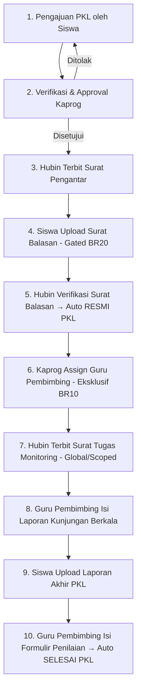
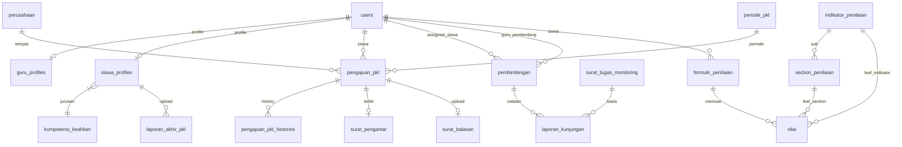

# AGENTS.md — Master AI Context & Project Specification
## Sistem Informasi PKL (SI-PKL) — SMKN 1 Kota Bekasi

> **Single Source of Truth** untuk seluruh AI Coding Assistant (Antigravity, Gemini, Claude, Cursor, Copilot) yang bekerja pada repositori ini. Seluruh pengembang dan AI Agent wajib membaca dan mematuhi dokumen ini sebelum menulis atau memodifikasi kode.

**Versi Dokumen:** 1.3  
**Tanggal Update:** 27 Juli 2026  
**Status:** Final & Active  

---

## 📋 Daftar Isi

1. [Ikhtisar Proyek & PRD](#1-ikhtisar-proyek--prd)
   - 1.1 [Latar Belakang & Tujuan](#11-latar-belakang--tujuan)
   - 1.2 [Ruang Lingkup & 4 Role Utama](#12-ruang-lingkup--4-role-utama)
   - 1.3 [10 Alur Bisnis Utama](#13-10-alur-bisnis-utama)
   - 1.4 [Matrix Otorisasi & Permission (RBAC)](#14-matrix-otorisasi--permission-rbac)
   - 1.5 [Daftar 32 Aturan Bisnis (BR1–BR32)](#15-daftar-32-aturan-bisnis-br1br32)
   - 1.6 [Keputusan Desain & Out of Scope](#16-keputusan-desain--out-of-scope)
2. [Spesifikasi & Arsitektur Teknis (TRD)](#2-spesifikasi--arsitektur-teknis-trd)
   - 2.1 [Tech Stack Utama](#21-tech-stack-utama)
   - 2.2 [Aturan Arsitektur & Konvensi Kode](#22-aturan-arsitektur--konvensi-kode)
   - 2.3 [Skema Detail 19 Tabel Database](#23-skema-detail-19-tabel-database)
   - 2.4 [State Machine & Conditional Gates](#24-state-machine--conditional-gates)
   - 2.5 [Derivasi Role Otomatis via Observer](#25-derivasi-role-otomatis-via-observer)
   - 2.6 [Penomoran Surat, PDF, & Notifikasi](#26-penomoran-surat-pdf--notifikasi)
   - 2.7 [Struktur Folder & Controller](#27-struktur-folder--controller)
3. [Sistem Desain UI/UX (DESIGN.md)](#3-sistem-desain-uiux-designmd)
   - 3.1 [Color Palette & Token System](#31-color-palette--token-system)
   - 3.2 [Semantic State Badges](#32-semantic-state-badges)
   - 3.3 [Tipografi & Type Scale](#33-tipografi--type-scale)
   - 3.4 [Komponen shadcn/ui Terdaftar](#34-komponen-shadcnui-terdaftar)
   - 3.5 [Iconography & Prinsip Elevasi UI](#35-iconography--prinsip-elevasi-ui)
4. [Katalog Installed Skills Repo](#4-katalog-installed-skills-repo)
5. [Aturan Teknis & Coding Conventions](#5-aturan-teknis--coding-conventions)
   - 5.1 [Laravel & Frontend Conventions](#51-laravel--frontend-conventions)
   - 5.2 [Prinsip Ponytail (Lazy Senior Dev Mode)](#52-prinsip-ponytail-lazy-senior-dev-mode)

---

## 1. Ikhtisar Proyek & PRD

### 1.1 Latar Belakang & Tujuan
SMKN 1 Kota Bekasi mengelola proses Praktik Kerja Lapangan (PKL) secara digital terpusat melalui sistem **SI-PKL**. Sistem ini menangani seluruh siklus PKL: pengajuan tempat PKL, verifikasi Kaprog, persuratan otomatis (Surat Pengantar, Surat Balasan, Surat Tugas Monitoring), penugasan Guru Pembimbing, pembimbingan/monitoring kunjungan, hingga penilaian akhir dan penutupan status siswa.

**Tujuan Utama:**
1. Mendigitalkan seluruh alur dari Pengajuan hingga status Resmi PKL dan Selesai PKL.
2. Persuratan otomatis dengan penomoran unik sequential dan arsip PDF.
3. Penugasan Guru Pembimbing eksklusif oleh Kaprog jurusan terkait.
4. Monitoring kunjungan terikat pada Surat Tugas Monitoring resmi (Global/Scoped).
5. Penilaian akhir terstruktur (Indikator Umum & Teknis Kejuruan + Sub-indikator opsional) dengan rata-rata otomatis.
6. Audit trail lengkap pada setiap perubahan status pengajuan.
7. Notifikasi in-app (Laravel DB Notification + Sonner Toast).

---

### 1.2 Ruang Lingkup & 4 Role Utama

> [!IMPORTANT]
> Sistem ini **hanya memiliki 4 role**. Tidak ada role tambahan seperti Wali Kelas, Orang Tua, atau Kepala Sekolah. Role di-derive otomatis dari kolom `guru_profiles.jabatan` via `GuruProfileObserver`.

| Role | Kode Role | Deskripsi & Akses Utama |
|---|---|---|
| **Siswa** | `siswa` | Mengajukan PKL, upload Surat Balasan (gated BR20), memantau status & riwayat PKL, upload Laporan Akhir, melihat Nilai Akhir. Layout: Mobile-first. |
| **Kaprog** | `kaprog` | Memverifikasi pengajuan siswa jurusannya, assign/ubah Guru Pembimbing per siswa (BR10), self-assign sebagai pembimbing ("Bimbingan Saya"), request Surat Tugas Scoped. |
| **Guru Pembimbing** | `guru_pembimbing` | Membimbing siswa yang di-assign, mengisi Laporan Kunjungan (gated Surat Tugas aktif), mengisi Formulir Penilaian (gated Laporan Akhir siswa, BR32). |
| **Hubin** | `hubin` | Mengelola master data (Perusahaan, Periode, Jurusan, Indikator/Section Penilaian), Kelola Akun / Nonaktifkan Kaprog (BR31), menerbitkan seluruh surat, Bundling & Cetak. |

---

### 1.3 10 Alur Bisnis Utama



---

### 1.4 Matrix Otorisasi & Permission (RBAC)

Permission string menggunakan format `<domain>.<aksi>` dalam Bahasa Indonesia.

| Permission String | Siswa | Kaprog | Guru Pembimbing | Hubin |
|---|:---:|:---:|:---:|:---:|
| `pengajuan.ajukan` | ✅ | ❌ | ❌ | ❌ |
| `pengajuan.lihat-sendiri` | ✅ | ❌ | ❌ | ❌ |
| `pengajuan.lihat` | ❌ | ✅ (Policy Jurusan) | ❌ | ✅ (Semua) |
| `pengajuan.setujui` / `pengajuan.tolak` | ❌ | ✅ (Policy Jurusan) | ❌ | ❌ |
| `surat.terbitkan` | ❌ | ❌ | ❌ | ✅ |
| `surat-balasan.upload` | ✅ (BR20) | ❌ | ❌ | ❌ |
| `surat-balasan.verifikasi` | ❌ | ❌ | ❌ | ✅ |
| `pembimbing.assign` | ❌ | ✅ (Eksklusif BR10) | ❌ | ❌ |
| `surat-tugas.terbitkan-global` | ❌ | ❌ | ❌ | ✅ |
| `surat-tugas.request-scoped` | ❌ | ✅ (Policy Jurusan) | ❌ | ❌ |
| `surat-tugas.terbitkan-scoped` | ❌ | ❌ | ❌ | ✅ |
| `kunjungan.isi` / `kunjungan.lihat` | ❌ | ✅ (Self-assign) | ✅ (Assigned) | ❌ |
| `laporan-akhir.upload` | ✅ | ❌ | ❌ | ❌ |
| `penilaian.isi` / `penilaian.lihat` | ❌ | ✅ (Self-assign) | ✅ (Gated BR32) | ❌ |
| `master-penilaian.kelola` | ❌ | ❌ | ❌ | ✅ |
| `master-data.kelola` / `akun.kelola` | ❌ | ❌ | ❌ | ✅ |
| `persuratan.bundling` | ❌ | ❌ | ❌ | ✅ |
| `riwayat.lihat-sendiri` | ✅ | ❌ | ❌ | ❌ |
| `dashboard.global` / `dashboard.jurusan` | ❌ | ✅ (`jurusan`) | ❌ | ✅ (`global`) |

---

### 1.5 Daftar 32 Aturan Bisnis (BR1–BR32)

> [!IMPORTANT]
> Seluruh 32 Business Rules wajib diterapkan secara ketat tanpa kompromi pada logic backend (Controller/Policy/Observer) dan frontend.

| Kode | Aturan Bisnis (Business Rule) |
|---|---|
| **BR1** | Siswa hanya dapat memiliki **satu pengajuan PKL aktif** (status `diajukan`/`disetujui`/`resmi_pkl`) pada satu waktu. Pengajuan baru untuk periode lain hanya bisa dibuat setelah pengajuan sebelumnya berstatus final (`ditolak`/`selesai_pkl`). |
| **BR2** | Pengajuan PKL wajib memilih Perusahaan dan Periode PKL dari data master — tidak ada input periode bebas. |
| **BR3** | Kaprog yang berwenang memverifikasi pengajuan adalah Kaprog dari jurusan yang sama dengan siswa (dimodifikasi via Laravel Policy). |
| **BR4** | Approve/Reject pengajuan **wajib dilakukan dari halaman detail pengajuan** (diakses via ghost button "Lihat detail"). Tidak boleh ada tombol aksi cepat approve/reject langsung di tabel list. |
| **BR5** | Pengajuan yang ditolak Kaprog dapat diajukan ulang oleh siswa yang bersangkutan. |
| **BR6** | Setiap perubahan status pengajuan WAJIB dicatat di `pengajuan_pkl_histories` sebagai audit trail (aktor, waktu, status_lama, status_baru, catatan). |
| **BR7** | Status **Resmi PKL** aktif secara OTOMATIS pada siswa setelah Surat Balasan diverifikasi Hubin — tidak ada tombol manual untuk mengubah status ini. |
| **BR8** | Dokumen pendukung pengajuan tersimpan pada record pengajuan dan dapat diakses Kaprog & Hubin saat verifikasi. |
| **BR9** | Surat Pengantar TIDAK BISA diterbitkan Hubin jika pengajuan belum berstatus `disetujui` oleh Kaprog. |
| **BR10** | Penugasan (Assign) Guru Pembimbing adalah **wewenang EKSKLUSIF Kaprog** jurusan siswa. Hubin tidak punya hak override. Kaprog dapat self-assign dirinya sendiri sebagai pembimbing. |
| **BR11** | Satu siswa hanya punya **satu Guru Pembimbing aktif** per periode. Penggantian pembimbing mengarsipkan record lama (`status = diarsipkan`) untuk menjaga histori. |
| **BR12** | Guru Pembimbing hanya dapat mengakses Laporan Kunjungan & Penilaian untuk siswa yang secara eksplisit di-assign kepadanya. |
| **BR13** | Status **Selesai PKL** aktif secara OTOMATIS setelah Nilai Akhir siswa terisi (Formulir Penilaian disubmit). |
| **BR14** | PKL ulang tidak memiliki alur/form khusus — siswa submit via form Pengajuan biasa. Pengajuan periode sebelumnya otomatis pindah ke Riwayat PKL. |
| **BR15** | Halaman Riwayat PKL menampilkan seluruh pengajuan siswa lintas periode beserta status akhirnya (ditolak/selesai/dibatalkan). |
| **BR16** | Penerbitan Surat Pengantar oleh Hubin hanya bisa dilakukan untuk pengajuan berstatus `disetujui`. |
| **BR17** | Nomor surat (Surat Pengantar & Surat Tugas Monitoring) bersifat **unik dan sequential** per jenis surat per periode/tahun ajaran. |
| **BR18** | Seluruh dokumen surat (Pengantar, Tugas Monitoring, Bundling) digenerate sebagai PDF, disimpan di storage server, dan dapat diunduh kapan saja. |
| **BR19** | Fitur Bundling & Cetak wajib menyediakan preview dokumen; tombol **Cetak** dan tombol **Kirim** dipisah tegas. Preview tidak boleh memicu aksi kirim. |
| **BR20** | Upload Surat Balasan oleh siswa **terkunci (conditional lock)** sampai Surat Pengantar resmi diterbitkan Hubin. |
| **BR21** | Komponen global **Search & Filter Bar** wajib dipakai di seluruh modul list/tabel sebagai komponen React reusable. |
| **BR22** | Pengisian Laporan Kunjungan oleh Guru Pembimbing hanya sah jika ada **Surat Tugas Monitoring aktif** yang diterbitkan Hubin. |
| **BR23** | Surat Tugas Monitoring memiliki 2 lingkup: **Global** (seluruh jurusan, diinisiasi Hubin) dan **Scoped** (satu jurusan, diterbitkan Hubin atas request Kaprog). |
| **BR24** | Indikator Penilaian terbagi 2 kategori: **Umum** (`kompetensi_keahlian_id = NULL`, berlaku global) dan **Teknis Kejuruan** (scoped per jurusan). |
| **BR25** | Formulir Penilaian memuat field: jumlah hari `sakit`, `izin`, `alpa`, `catatan_guru_pembimbing`, dan `nama_pembimbing_industri`. |
| **BR26** | Section Penilaian (sub-indikator) bersifat **nullable (opsional)**. Jurusan tanpa kebutuhan sub-indikator langsung dinilai di level Indikator. |
| **BR27** | Struktur hierarki penilaian maksimal 2 level: Indikator → Section (tidak ada sub-sub-indikator). |
| **BR28** | **Nilai Akhir** dihitung otomatis sebagai rata-rata dari seluruh leaf element yang terisi (Section jika ada, atau Indikator jika tidak ada Section). |
| **BR29** | Skala predikat penilaian bersifat statis: **K** (<70), **C** (70–80), **B** (81–90), **SB** (91–100). |
| **BR30** | Penggantian Guru Pembimbing hanya untuk kasus permanen (resign/pindah). Ketidakhadiran pembimbing saat sidang diselesaikan via penjadwalan ulang, bukan ganti pembimbing. |
| **BR31** | Aksi "Nonaktifkan sebagai Kaprog" oleh Hubin otomatis mengubah role staf tersebut menjadi `guru_pembimbing` via Observer (`GuruProfileObserver`). |
| **BR32** | Formulir Penilaian **terkunci (gated)** dan baru terbuka bagi Guru Pembimbing setelah Siswa mengunggah Laporan Akhir PKL. Diisi sekali menjelang sidang. |

---

### 1.6 Keputusan Desain & Out of Scope

- **Keputusan Utama:** Predikat fixed K/C/B/SB (BR29), Form Penilaian mencakup kehadiran & catatan (BR25), Nonaktif Kaprog via Observer (BR31), Jurusan menggunakan tabel `kompetensi_keahlian`, UI dibangun sesuai `DESIGN.md` sejak M0.
- **Out of Scope:** Tidak ada alur keuangan/biaya, tidak ada integrasi SSO/e-meterai, notifikasi strictly in-app (bukan WA/Email/SMS), tidak ada mobile app native (web responsive mobile-first untuk Siswa).

---

## 2. Spesifikasi & Arsitektur Teknis (TRD)

### 2.1 Tech Stack Utama

| Layer | Teknologi & Versi |
|---|---|
| **Language** | PHP 8.4 (Backend), TypeScript / React 19 (Frontend) |
| **Framework Backend** | Laravel 13 |
| **Frontend Bridge** | Inertia.js v3 (`@inertiajs/react` v3) |
| **Styling** | Tailwind CSS v4 |
| **UI Component Library** | shadcn/ui |
| **Database** | MySQL |
| **Authorization** | Spatie `laravel-permission` |
| **Icon Library** | Lucide React (`lucide-react`) |
| **Notification System** | Laravel Database Notification + Sonner Toast |
| **Excel Export/Import** | Laravel Excel (`maatwebsite/excel`) |
| **PDF Generation** | DomPDF (`barryvdh/laravel-dompdf`) via Blade Templates |

---

### 2.2 Aturan Arsitektur & Konvensi Kode

1. **Namespace Controller per Role:** Controller dipisah ke subfolder `Siswa/`, `Kaprog/`, `GuruPembimbing/`, dan `Hubin/`.
2. **Fresh Shared Data (`Inertia::share`):** Seluruh data global (user, permission, notifikasi) di `HandleInertiaRequests` wajib dibungkus Closure `fn()` agar tidak cached antar-request.
3. **Policy-Based Data Scoping:** Ownership/scoping (misal: Kaprog hanya bisa lihat siswa jurusannya) WAJIB menggunakan Laravel Policy (`$this->authorize(...)`). DILARANG membuat percabangan `if ($user->hasRole(...))` di dalam Controller.
4. **Form Handling React:** DILARANG menggunakan tag HTML `<form>` di React. Seluruh submit dilakukan via event handler (`onClick`) memanggil Inertia `useForm` atau `router.post/put/patch`.
5. **Bahasa Kode & Komentar:** Seluruh nama variabel, method, skema DB, dan komentar wajib menggunakan **Bahasa Indonesia**.

---

### 2.3 Skema Detail 19 Tabel Database



#### Skema Detail Tabel Core

##### 1. `pengajuan_pkl`
- `id` (bigint PK)
- `siswa_id` (fk → `users`)
- `perusahaan_id` (fk → `perusahaan`)
- `periode_pkl_id` (fk → `periode_pkl`)
- `status` (enum: `diajukan`, `disetujui`, `ditolak`, `resmi_pkl`, `selesai_pkl`)
- `catatan_verifikasi` (text, nullable — wajib diisi saat reject, BR6)
- `dokumen_pendukung` (string, nullable — path file, BR8)
- `created_at`, `updated_at` (timestamp)

##### 2. `pengajuan_pkl_histories` (Audit Trail BR6)
- `id` (bigint PK)
- `pengajuan_pkl_id` (fk → `pengajuan_pkl`)
- `status_lama` (string, nullable)
- `status_baru` (string)
- `aktor_id` (fk → `users`)
- `catatan` (text, nullable)
- `created_at` (timestamp)

##### 3. `surat_pengantar` & `surat_tugas_monitoring`
- `id` (bigint PK)
- `nomor_surat` (string unique — sequential BR17)
- `pengajuan_pkl_id` (fk → `pengajuan_pkl`, khusus surat pengantar)
- `lingkup` (enum: `global`, `scoped`, khusus surat tugas monitoring)
- `kompetensi_keahlian_id` (fk → `kompetensi_keahlian`, nullable, khusus scoped)
- `diterbitkan_oleh` (fk → `users`)
- `file_pdf` (string — path PDF storage)
- `created_at` (timestamp)

##### 4. `pembimbingan` (BR10 & BR11)
- `id` (bigint PK)
- `siswa_id` (fk → `users`)
- `guru_pembimbing_id` (fk → `users`)
- `assigned_by` (fk → `users`, Kaprog)
- `status` (enum: `aktif`, `diarsipkan`)
- `is_self_assign` (boolean — true jika Kaprog self-assign)
- `created_at`, `updated_at` (timestamp)

##### 5. `indikator_penilaian` & `section_penilaian` (BR24 & BR26)
- `indikator_penilaian`: `id`, `nama`, `kategori` (enum: `umum`, `teknis_kejuruan`), `kompetensi_keahlian_id` (fk nullable), `urutan`.
- `section_penilaian`: `id`, `indikator_penilaian_id` (fk), `nama`, `urutan` (nullable sub-indikator).

##### 6. `formulir_penilaian` & `nilai` (BR25, BR28, BR32)
- `formulir_penilaian`: `id`, `siswa_id`, `periode_pkl_id`, `guru_pembimbing_id`, `sakit` (int), `izin` (int), `alpa` (int), `catatan_guru_pembimbing` (text, nullable), `nama_pembimbing_industri` (string), `nilai_akhir` (decimal, nullable), `submitted_at` (timestamp, nullable).
- `nilai`: `id`, `formulir_penilaian_id` (fk), `indikator_penilaian_id` (fk nullable), `section_penilaian_id` (fk nullable), `nilai` (decimal 0-100), `predikat` (enum: `K`, `C`, `B`, `SB`).

---

### 2.4 State Machine & Conditional Gates

1. **Status Pengajuan PKL:**  
   `diajukan` ➔ *(Kaprog Approve)* ➔ `disetujui` ➔ *(Hubin Terbit Surat Pengantar)* ➔ *(Siswa Upload Surat Balasan)* ➔ *(Hubin Verifikasi)* ➔ `resmi_pkl` ➔ ... ➔ *(Submit Penilaian)* ➔ `selesai_pkl`.
2. **Gate Upload Surat Balasan (BR20):**  
   Tombol Upload locked sampai record `surat_pengantar` terbit.
3. **Gate Formulir Penilaian (BR32):**  
   Formulir Penilaian locked bagi Guru Pembimbing sampai Siswa mengunggah `laporan_akhir_pkl`.
4. **Gate Laporan Kunjungan (BR22):**  
   Pengisian Laporan Kunjungan hanya bisa dilakukan jika ada `surat_tugas_monitoring` berstatus aktif.

---

### 2.5 Derivasi Role Otomatis via Observer

> [!CAUTION]
> DILARANG menetapkan role Spatie secara manual via UI. Seluruh role staf di-sync otomatis dari kolom `guru_profiles.jabatan` oleh `GuruProfileObserver`.

```php
// app/Observers/GuruProfileObserver.php
public function saved(GuruProfile $profile): void
{
    $roleMap = [
        'Kaprog' => 'kaprog',
        'Guru Pembimbing' => 'guru_pembimbing',
        'Staf Hubin' => 'hubin',
    ];

    if (isset($roleMap[$profile->jabatan])) {
        $profile->user->syncRoles([$roleMap[$profile->jabatan]]);
    }
}
```

---

### 2.6 Penomoran Surat, PDF, & Notifikasi

- **Sequential Numbering (BR17):** Nomor surat digenerate saat publikasi dalam DB Transaction dengan `lockForUpdate()`.
- **Generasi PDF (BR18):** DomPDF merender template Blade ke `storage/app/surat/`.
- **Audit Trail (BR6):** Setiap perubahan status pengajuan mencatat aktor, timestamp, status lama & baru ke `pengajuan_pkl_histories`.
- **Notifikasi In-App:** Event penting memicu Laravel Database Notification + toast Sonner di UI.

---

### 2.7 Struktur Folder & Controller

```
app/
├── Http/Controllers/
│   ├── Siswa/             # PengajuanController, SuratBalasanController, RiwayatController, LaporanAkhirController
│   ├── Kaprog/            # PengajuanController, PembimbinganController, SuratTugasRequestController, DashboardController
│   ├── GuruPembimbing/    # KunjunganController, PenilaianController
│   └── Hubin/             # MasterDataController, IndikatorPenilaianController, AkunController, SuratController, BundlingController, DashboardController
├── Models/                # Model Eloquent
├── Policies/              # PengajuanPolicy, PembimbinganPolicy, KunjunganPolicy, PenilaianPolicy
├── Observers/             # GuruProfileObserver
└── Notifications/         # Notification Classes
```

---

## 3. Sistem Desain UI/UX (DESIGN.md)

### 3.1 Color Palette & Token System

Token CSS dikonfigurasi di `resources/css/tokens.css` sebagai *Single Source of Truth*.

| Token Name | Color Hex | Role & Kegunaan |
|---|---|---|
| `--color-primary` | `#4169E1` (Royal Blue) | Tombol utama, active link, active nav, focus ring, header/sidebar accent |
| `--color-accent` | `#FFA500` (Bright Orange) | CTA sekunder / highlight non-status (tombol Cetak vs Kirim) |
| `--color-background` | `#FAFAFA` (Bright Snow) | Base background halaman light mode |
| `--color-fg` | `#111827` | Teks utama |
| `--color-fg-muted` | `#6B7280` | Teks sekunder / caption |
| `--color-border` | `#E5E7EB` | Border kartu, input field, divider |
| `--color-surface` | `#FFFFFF` | Surface panel / kartu di atas background snow |

---

### 3.2 Semantic State Badges

Format badge: Pill, soft background + text warna pekat (kontras AA), **tanpa border & tanpa shadow**.

| Semantic State | Text Hex / Background Hex | Mapping Entity State |
|---|---|---|
| **Success** | `#166534` / `#DCFCE7` | `disetujui`, `resmi_pkl`, `selesai_pkl`, `submitted`, `aktif` |
| **Warning** | `#854D0E` / `#FEF9C3` | Menunggu tindakan lanjutan, reminder |
| **Danger** | `#991B1B` / `#FEE2E2` | `ditolak`, `nonaktif`, error validasi |
| **Info** | `#1E40AF` / `#DBEAFE` | `diajukan` (menunggu verifikasi Kaprog) |
| **Neutral** | `#374151` / `#F3F4F6` | `draft`, `diarsipkan` |

---

### 3.3 Tipografi & Type Scale

- **Heading Font:** **Plus Jakarta Sans** (Weight 600 Semibold / 700 Bold)
- **Body Font:** **Lato** (Weight 400 Regular / 700 Bold)

| Role | Font Size / Line Height | Font Family | Weight |
|---|---|---|---|
| **H1** | 32px / 40px | Plus Jakarta Sans | 700 |
| **H2** | 24px / 32px | Plus Jakarta Sans | 600 |
| **H3** | 20px / 28px | Plus Jakarta Sans | 600 |
| **H4 (Judul Kartu)** | 16px / 24px | Plus Jakarta Sans | 600 |
| **Body** | 14px / 20px | Lato | 400 |
| **Body Emphasis** | 14px / 20px | Lato | 700 |
| **Caption / Meta** | 12px / 16px | Lato | 400 |

---

### 3.4 Komponen shadcn/ui Terdaftar

Hanya 10 komponen shadcn/ui berikut yang diizinkan digunakan di proyek ini:

1. **Alert Dialog (`size=sm`):** Wajib untuk seluruh konfirmasi kritikal (Approve/Reject, Cetak/Kirim, Nonaktif Kaprog, Submit Penilaian). DILARANG `window.confirm()`.
2. **Attachment:** Upload & preview file (Surat Balasan, Laporan Akhir, foto monitoring multi-file).
3. **Avatar Dropdown:** Disederhanakan 2 item ("Settings" & "Log out").
4. **Button:** 6 varian (`Primary`, `Secondary`, `Outline`, `Ghost`, `Destructive`, `Link`).
5. **Checkbox:** Filter multi-pilih & bulk-select Data Table.
6. **Combobox:** Autocomplete Perusahaan & dropdown assign Guru Pembimbing.
7. **Data Table:** Seluruh halaman rekap/list data, terintegrasi Search & Filter Bar (BR21).
8. **Date Picker:** Input tanggal pelaksanaan, kunjungan, & penilaian.
9. **Skeleton:** Loading state pengganti spinner generik.
10. **Sonner:** Toast notification feedback aksi pengguna.

---

### 3.5 Iconography & Prinsip Elevasi UI

- **Icon Set:** Wajib `lucide-react` (bukan Tabler Icons).
- **Prinsip Elevasi:** DILARANG menggunakan `box-shadow` dekoratif atau glow effect. Elevasi kartu murni mengandalkan `--color-border` dan `--color-surface`.
- **Pola Layout Navigasi:**
  - **Siswa (Mobile-First):** Bottom Navigation + Hamburger Sheet + FAB kontekstual.
  - **Staf (Kaprog/Guru Pembimbing/Hubin):** Desktop Admin Sidebar.

---

## 4. Katalog Installed Skills Repo

Proyek ini dilengkapi dengan 8 Skill Lokal di folder `.agents/skills/`. Aktifkan skill yang relevan sebelum mengerjakan tugas terkait:

| Skill | Path SKILL.md | Kapan Harus Diaktifkan |
|---|---|---|
| `fortify-development` | `.agents/skills/fortify-development/SKILL.md` | Pengerjaan fitur autentikasi (login, register, 2FA, reset password, update profile, Fortify config). |
| `frontend-design` | `.agents/skills/frontend-design/SKILL.md` | Merancang atau mereshape UI React, penataan layout visual, styling custom, aesthetic direction. |
| `inertia-react-development` | `.agents/skills/inertia-react-development/SKILL.md` | Membuat halaman/komponen React Inertia v3, penggunaan `useForm`, `useHttp`, `router`, prefetching, polling, deferred props. |
| `laravel-best-practices` | `.agents/skills/laravel-best-practices/SKILL.md` | Menulis/refactoring backend PHP, Controller, Model, Migration, Form Request, Policy, DB query optimization (N+1). |
| `pest-testing` | `.agents/skills/pest-testing/SKILL.md` | Menulis, memperbaiki, atau merefaktor pengujian Pest PHP (`tests/Feature`, `tests/Unit`, assertions, datasets, mocking). |
| `shadcn` | `.agents/skills/shadcn/SKILL.md` | Mengelola, menambah, memodifikasi komponen `shadcn/ui`, `components.json`, styling preset. |
| `tailwindcss-development` | `.agents/skills/tailwindcss-development/SKILL.md` | Penggunaan Tailwind CSS v4 utility classes, layout responsive grid/flex, penyesuaian tokens CSS. |
| `wayfinder-development` | `.agents/skills/wayfinder-development/SKILL.md` | Menghubungkan frontend React ke Laravel Controller via Wayfinder typed route functions (`@/actions` / `@/routes`). |

---

## 5. Aturan Teknis & Coding Conventions

### 5.1 Laravel & Frontend Conventions
- **PHP 8.4 Rules:** Gunakan constructor property promotion, explicit return types, strict typing, dan PHPDoc array shapes.
- **Inertia v3:** Manfaatkan `useHttp` untuk request terpisah, optimistic updates, dan `useLayoutProps`.
- **Laravel Boost Tools:** Gunakan MCP tool Boost (`database-query`, `database-schema`, `search-docs`) untuk dokumentasi & inspect DB.
- **Testing Enforcement:** Setiap perubahan logika backend wajib diikuti pengujian Pest yang relevan (`php artisan test --compact`).

---

### 5.2 Prinsip Ponytail (Lazy Senior Dev Mode)

> **Kode terbaik adalah kode yang tidak perlu ditulis.**

Sebelum menulis kode baru, lakukan evaluasi dengan tangga keputusan:
1. **YAGNI:** Apakah fitur ini benar-benar dibutuhkan sekarang?
2. **Reuse:** Apakah helper, utility, atau pola ini sudah ada di codebase? Gunakan kembali.
3. **Stdlib & Native:** Gunakan fungsi bawaan PHP/React/Tailwind sebelum menambah dependency baru.
4. **One-liner:** Jika bisa ditulis dalam 1 baris bersih, buat 1 baris.
5. **Minimal Diff:** Tuliskan kode minimum yang menyelesaikan akar masalah, bukan sekadar menutupi gejala (symptom masking).

---

> **SI-PKL SMKN 1 Kota Bekasi** — Dokumentasi ini dijaga tetap sinkron dengan `docs/PRD.md`, `docs/TRD.md`, dan `DESIGN.md`.
